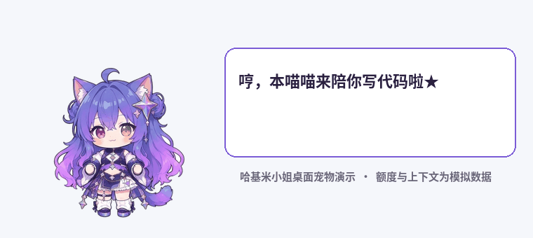

# Gemini Desktop Pet | 哈基米小姐桌面宠物

第三方 Antigravity 桌面陪伴程序（Gemini 猫娘 / 哈基米小姐），与 Google 官方无隶属关系。



上图额度、上下文及缓存命中率为模拟数据，不代表真实账户状态。演示图中的文字仅供展示。

## 功能

- 透明无边框置顶窗口（10 组动作共 130 帧 RGBA PNG），支持桌面拖动、自动巡逻漫步、16 帧入睡/呼吸泡泡/伸懒腰唤醒、动作预览与对话气泡。
- 根据 Antigravity 本地会话日志（`~/.gemini/antigravity/brain/*/.system_generated/logs/transcript.jsonl`）及 Hook 日志自动联动任务开始（侧面奔跑）、完成（跳跃）与中断（委屈表情）；陈旧会话记录不会阻塞睡眠。
- 与 `antigravity-pulse` 对话栏底部状态同步显示上下文窗口占用与缓存命中率，并在「查询额度」中汇总近 5 小时 / 今日真实 Token 消耗，同时安全读取 `account-switcher` 本地非凭证配额快照及重置状态（过期或无数据时如实提示，不编造数值）。
- 提供 Linux 和 Windows 11 启动与打包脚本；支持右键开关机启动与跟随 Antigravity 主进程自动启停。Windows 11 打包脚本尚未在 Windows 实机验证。

程序仅读取本机运行进程信息、会话日志与插件持久化数据，不上传任何对话或凭证内容。请仅在信任本程序的环境运行。

## 运行

- Linux：参见 [Linux 说明](packaging/linux/README.md)，需要 Python 3.10+、PyQt5 和图形桌面；也可直接下载 Release 中的 `gemini-desktop-pet-v1.0.0-linux.tar.gz`，解压后运行 `./start.sh` 或 `./follow-antigravity.sh`。
- Windows 11：参见 [Windows 说明](packaging/windows/README.md)；下载 Release 中的 `gemini-desktop-pet-v1.0.0-win11.zip`，解压后依次运行 `setup.bat`、`standalone.bat` / `follow-antigravity.bat`（或 `build.bat` 构建独立 EXE）。它是源码运行与构建包，不含预编译 EXE。
- 本地运行测试与生成双平台发布包：

```bash
python3 -m unittest discover -s tests -v
python3 packaging/create_packages.py
```

生成文件位于 `dist/`。资源位于 `assets/transparent-v2/`，可运行 `python3 build_v2_sprites.py` 重新构建动画帧。

## 调研、参考与致谢

- **架构与跨平台打包参考**：[rzls420420/codex-desktop-pet](https://github.com/rzls420420/codex-desktop-pet)（白龙小姐桌面宠物），参考其透明桌宠窗体、状态机、动画调度、跟随监控、开机自启与 Linux / Windows 11 打包发布结构。
- **角色立绘与基础动作图片来源**：[lokicorvus/crosspet](https://github.com/lokicorvus/crosspet)（`characters/gemini/` 目录下的开源透明 Gemini 娘素材库），提供待机、工作、思考、等待、委屈及表情基础帧。
- **角色原画设定来源**：源自 B 站 / Pixiv 创作者 **ZipZipPipe（胖次狐）** 的社区 Gemini 拟人化设定，角色美术素材遵循 **CC BY-NC-SA 4.0（署名-非商业性使用-相同方式共享）** 国际许可协议。
- **连贯动作补全**：眨眼挥手（`idle-waving`）、侧身四步迈腿奔跑（`running`）、床铺入睡呼吸泡泡及伸懒腰起床（`sleep`）等动作序列基于上述角色参考图重新绘制去背，并结合预乘 Alpha 过渡扩展为 2 倍连贯帧率。
- **插件数据对接**：上下文窗口占用与缓存命中率、近 5 小时/今日用量格式对齐 `antigravity-pulse` 插件（`history-v1` / `usage-v1`）；账号配额快照读取自 `account-switcher` 本地非凭证展示字段。

公开展示不代表对第三方角色或参考图授予额外权利；本项目 Python 代码遵循 MIT 协议，美术素材请遵循原画及 CrossPet 项目的 CC BY-NC-SA 4.0 许可协议。
